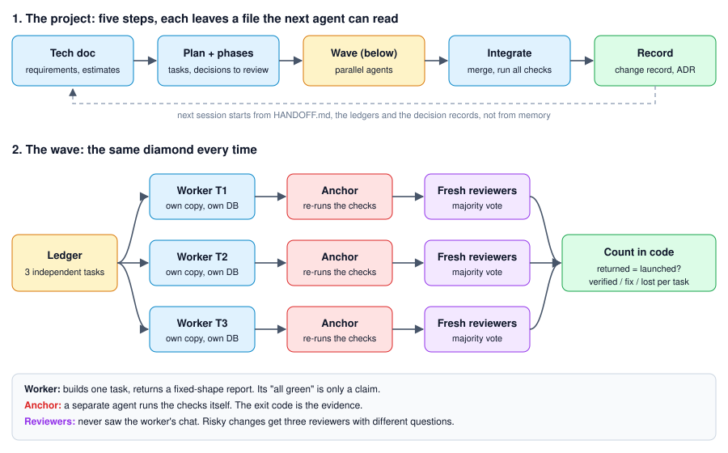

# backend-agent-kit

Build a backend with many Claude Code agents in parallel, without losing control of it.



## The problem

One agent works fine. Five agents in parallel break in predictable ways:

- They forget. A new session knows nothing about the last one.
- They say "all green" without running anything.
- They overwrite each other's files.
- They grade their own work.
- One usage limit kills all of them at once.

## What the kit does

| Problem | Fix |
| --- | --- |
| Forgetting | Everything lives in files: a handoff note, per-phase ledgers, change records, decision records |
| Fake "green" | A separate agent re-runs the checks. Its exit code is the evidence |
| File collisions | One task per copy or worktree, one database and port range per agent, a fixed list of writable files |
| Self-grading | Reviewers start fresh and never see the worker's chat. Risky changes get three reviewers and a majority vote |
| Limits | Workers save a patch after every green step. A wave never closes if fewer agents returned than were launched |
| Drift | The scaffold enforces layering and clock/ID rules with tools, not prose |

A wave only makes sense for three or more independent tasks. Otherwise the kit tells you to use one agent.

## Install

```text
/plugin marketplace add erharshbhatia/backend-agent-kit
/plugin install backend-agent-kit@backend-agent-kit
```

## Use

```text
/backend-agent-kit:bootstrap my-service python-service   start a project
/backend-agent-kit:wave P01                               run a wave of parallel agents
/backend-agent-kit:status                                 where are we
/backend-agent-kit:handoff                                end the session cleanly
/backend-agent-kit:audit                                  check docs against each other
```

## What is inside

| Folder | What |
| --- | --- |
| `skills/` | The process: tech doc, plan, lifecycle, standards, change records, ledgers, multi-agent rules |
| `workflows/wave.js` | The wave from the diagram, as a script for Claude Code's Workflow tool |
| `commands/`, `agents/` | The commands above; worker, reviewer, auditor and integrator agents |
| `hooks/` | Blocks `pkill`, force push, volume deletes, database drops, hard reset in kit projects |
| `templates/` | Files copied into your project: `CLAUDE.md`, invariants, ledgers |
| `scaffolds/` | A runnable service skeleton per stack. Today: Python, FastAPI, Postgres |

## Stacks

The skills never name a tool. Each project has a `STACK.md` that says what `check`, `deps-sync` and "composition root" mean for its stack. Python is the only one built. TypeScript and Go are open: see `scaffolds/CONTRACT.md`.

## Benchmark

None yet. First project built with the kit: 1,335 unit tests, 271 database tests and 22 end-to-end scenarios in four days, six workers lost at once to a usage limit, 70 audit findings merged by hand. Every wave now writes a metrics row in `HANDOFF.md`. Those rows are the benchmark.

## Contribute

A metrics row from real work, a new stack, or a skill fix with the failure behind it. See `CONTRIBUTING.md`. MIT licensed.
